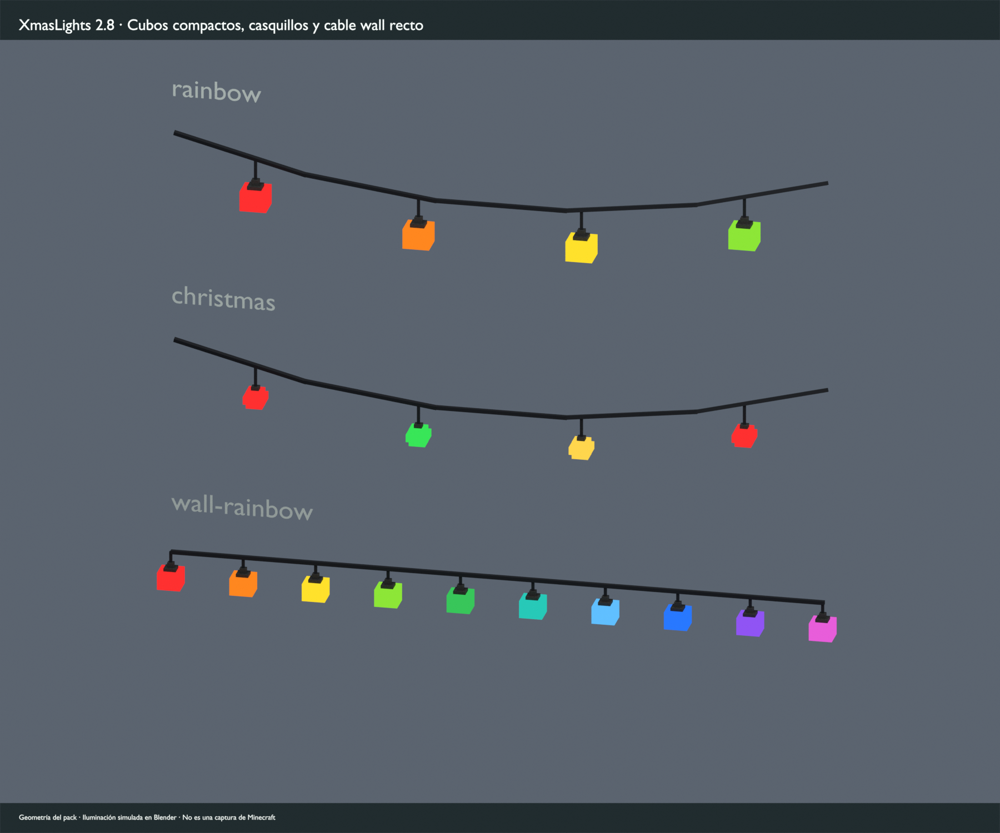
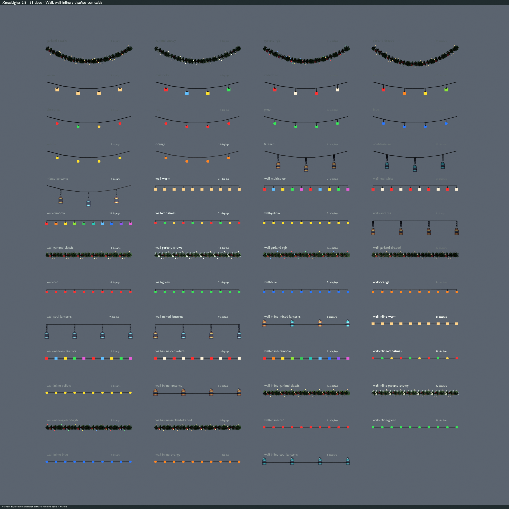

# Renders de XmasLights 2.8

El [detalle de cuelgues y cubos](07-cables-and-cubes.png) y el
[catálogo de los 51 tipos](08-all-light-types.png) usan las **matrices exactas que el plugin
envía a sus displays**, exportadas por las pruebas, y los JSON/texturas reales del pack.
Los farolillos y cadenas se leen de un cliente local Minecraft 1.21.4; esos recursos
no se añaden al pack de XmasLights.

La iluminación es de estudio en Blender. **No son capturas de Minecraft ni validan
el resultado del shader de StrobeLights**. La colocación y estabilidad de los impactos RGB
están comprobadas por pruebas; su aceptación visual requiere un cliente con el pack y Fabulous.





| Imagen | Contenido |
| --- | --- |
| [09 — Cable central](09-wall-inline-comparison.png) | Comparación de pared con cuelgue y bombilla centrada sin ramal |
| [07 — Cables y cubos](07-cables-and-cubes.png) | Rainbow, Christmas y Wall Rainbow: caída, cuelgues, casquillos y colores |
| [08 — Los 51 tipos](08-all-light-types.png) | Todos los diseños integrados, con su coste de displays por tramo de seis metros |
| [01 — Abeto clásico](01-classic-door.png) | Lazos, piñas, bolas y LED cálidos en una puerta |
| [02 — Detalle de abeto](02-model-closeups.png) | Clásico, nevado y multicolor |
| [03 — RGB nocturno](03-rgb-night.png) | Geometría del abeto con iluminación de superficies simulada |
| [04 — Escalera](04-draped-stairs.png) | Garland Draped, caída de 0.20 |
| [05 — Frente y reverso](05-front-and-back.png) | Adornos por ambas caras y LED enrollados |
| [06 — Bombillas](06-colored-bulbs.png) | Rojo, verde, azul, amarillo, naranja y paleta Christmas |

Las escenas editables están en [catálogo](XmasLights-2.8-catalog.blend),
[cables](XmasLights-2.8-cables.blend) y [detalle de bombillas](XmasLights-model-review.blend).
La [escena nocturna anterior](XmasLights-2.5-night.blend) incluye impactos simulados en Blender de la revisión 2.5; no representa los nuevos ajustes RGB de 2.8.
El manifiesto de transformaciones es [design-manifest.json](design-manifest.json).

Para regenerar el catálogo desde el código Java y el pack actuales:

```powershell
./mvnw.cmd test '-Dtest=LightDesignReviewTest' '-Dxmaslights.preview.manifest=previews/design-manifest.json'
blender --background --python tools/render_catalog.py -- --minecraft-jar=C:/ruta/1.21.4.jar
```

Los otros seis renders se generan con `blender --background --python tools/render_previews.py`.
`-- --only=06-colored-bulbs` permite elegir uno. `tools/build_models.py` reconstruye
los modelos y el ZIP desde su fuente editable; requiere Pillow.

El abeto mantiene **dos displays por módulo**, con 186 caras en total; junto a apoyo
opaco completo usa 112 caras con las mismas entidades. Los bordes visibles de las bolas
y bombillas conservan sus caras para evitar huecos. Los casquillos están integrados en
el modelo de cada lámpara. Los cuelgues normales usan cable fino; los farolillos, cadena.
El modo vanilla conserva curvas y cuelgues con materiales de Minecraft y no descarga el pack.

El [icono del pack](../model-pack/pack.png) conserva su [fuente y prompt](../docs/PACK_ICON.md).

## Cable centrado en 2.8

[Comparación wall / wall-inline](09-wall-inline-comparison.png): misma paleta,
bombilla centrada en el cable, sin ramal ni casquillo superior en cubos y bombillas. Los costes corresponden a seis metros
reales del plugin; los farolillos nativos también quedan centrados por su cuerpo.
Escena editable: [XmasLights-2.8-inline.blend](XmasLights-2.8-inline.blend).
Los renders de modelos usan iluminación de estudio de Blender. La corrección RGB se
comprueba por separado con GLSL real en GPU, según [el informe](../docs/STABLE_RGB.md).
